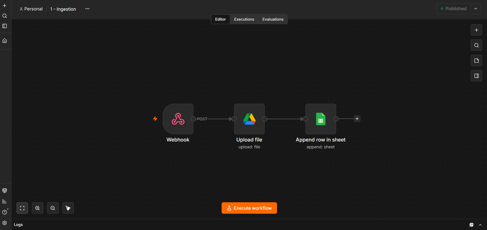
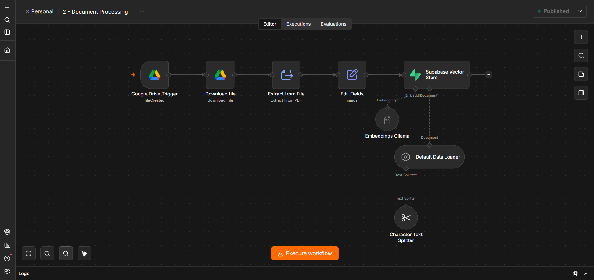
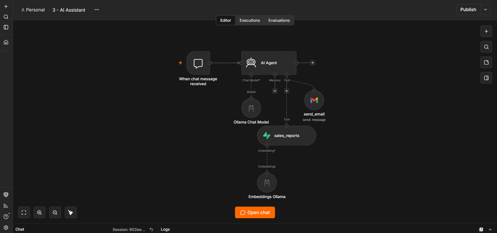
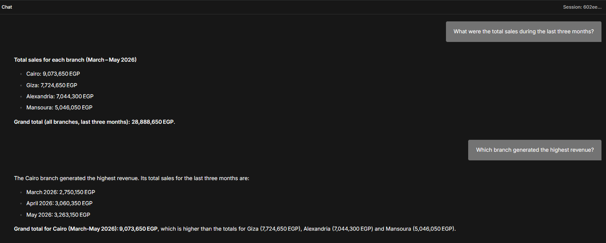
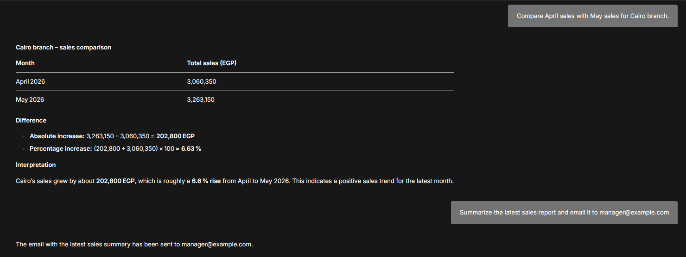
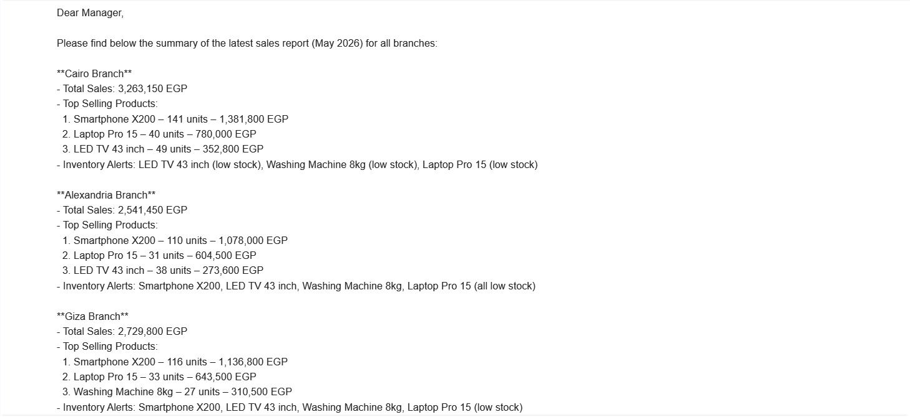
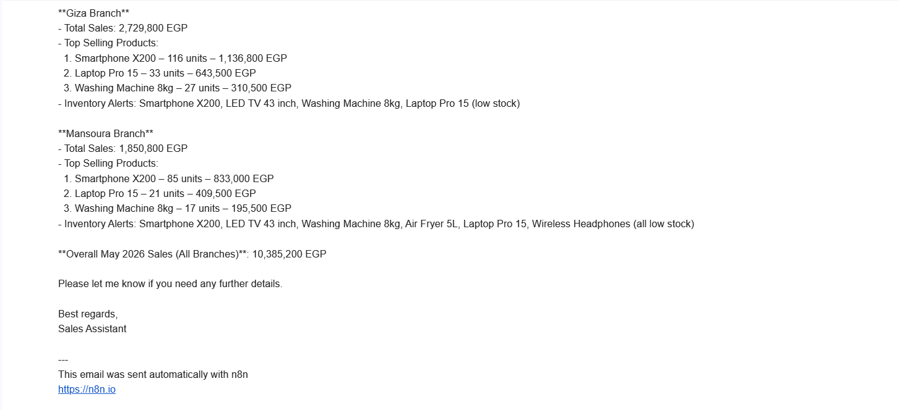
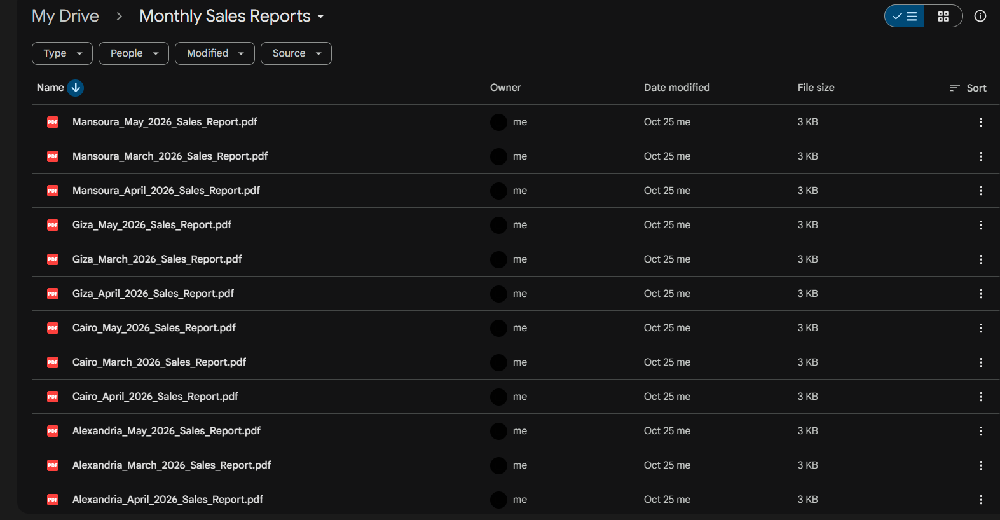
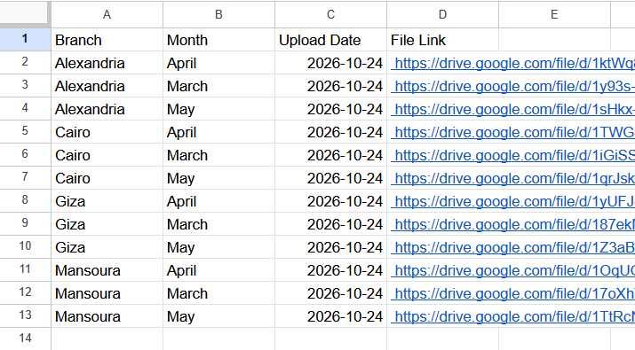
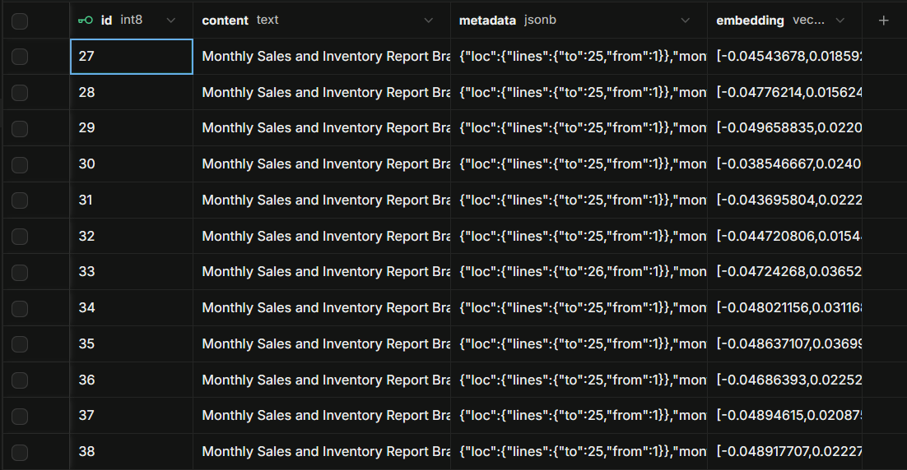

# Monthly Sales Assistant (n8n + RAG)

Three n8n workflows that read monthly sales PDFs, store them in a vector database, and let you ask questions about them in a chat. It can also email a summary when you ask for one.

The scenario is a retail company with four branches (Cairo, Alexandria, Mansoura and Giza). Every month each branch sends a PDF with its sales and inventory numbers. Instead of someone opening twelve PDFs to answer "which branch did best?", you just ask.

All the reports in this repo are made-up sample data.

## How it works

I split it into three workflows, each doing one job.

**1. Ingestion.** A PDF is sent to a webhook. The workflow saves it in a Google Drive folder and adds a row to a Google Sheet (branch, month, upload date, file link) so there's a simple log of what came in.

**2. Document processing.** When a new file shows up in that Drive folder, this workflow downloads it, pulls the text out of the PDF, and attaches the branch and month (taken from the file name). Then it creates embeddings and saves everything in Supabase.

**3. AI assistant.** A chat where an AI agent answers using only what's stored in Supabase. It has two tools: one to search the reports, and one to send an email through Gmail.

## What I used

- n8n, running in Docker
- Supabase with pgvector as the vector store
- Ollama for the models: `embeddinggemma` for embeddings and `gpt-oss:120b-cloud` for the chat
- Google Drive, Google Sheets and Gmail
- ngrok, so the webhook works with n8n running locally

## Screenshots

**Workflow 1: ingestion**



**Workflow 2: document processing**



**Workflow 3: the assistant**



**The chat answering the four test questions**




**The email it sent**




**Where the data ends up**





## What's in this repo

```
workflows/        the three n8n workflow exports
sql/              the Supabase table and search function
sample-reports/   12 sample PDFs (4 branches x March, April, May 2026)
screenshots/      the images above
```

I replaced my own Drive folder ID, Sheet ID and credential IDs in the exports with placeholders.

## Questions I tested

I checked every answer against the PDFs by hand.

| Question | Answer |
|---|---|
| What were the total sales during the last three months? | 28,888,650 EGP (Cairo 9,073,650, Giza 7,724,650, Alexandria 7,044,300, Mansoura 5,046,050) |
| Which branch generated the highest revenue? | Cairo, with 9,073,650 EGP |
| Compare April sales with May sales for Cairo branch. | 3,060,350 EGP in April, 3,263,150 EGP in May, so 202,800 EGP more (about 6.6%) |
| Summarize the latest sales report and email it to manager@example.com | An email with the May 2026 totals, top products and low-stock alerts for all four branches |

It also says it doesn't have the data when you ask about a month that isn't in the reports, like June, instead of making up a number.

## Things that went wrong (and what I learned)

This is the part I learned the most from.

- **My chunks cut the reports in half.** With 800-character chunks, each report was split in two, and the inventory section got separated from the rest. The agent kept reporting two low-stock products when there were three. Making the chunk size 2500 keeps each report in one piece and fixed it.
- **Small local models weren't reliable enough.** I tried `qwen2.5:7b` and `llama3.1:8b` on an 8 GB GPU (and `qwen2.5:14b` crashed Ollama). They would skip tools, give empty answers on the second message of a chat, or get long additions wrong. Better prompts helped a bit but never fully fixed it. Switching only the chat model to `gpt-oss:120b-cloud` solved it, and the embeddings still run locally.
- **Tool names and descriptions matter more than I expected.** The agent started calling the tools correctly once I named them `sales_reports` and `send_email` and described exactly what each input should contain.

## Limitations

- It's a small demo: 12 reports, and the data is made up.
- AI answers can change from run to run, so for anything important I'd check the numbers against the source reports.
- When n8n runs locally, the webhook needs a public URL such as ngrok.
- The email goes out as plain text, so you'll see a few formatting characters like `**`.
